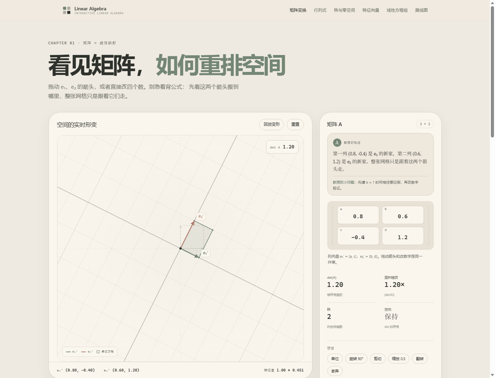
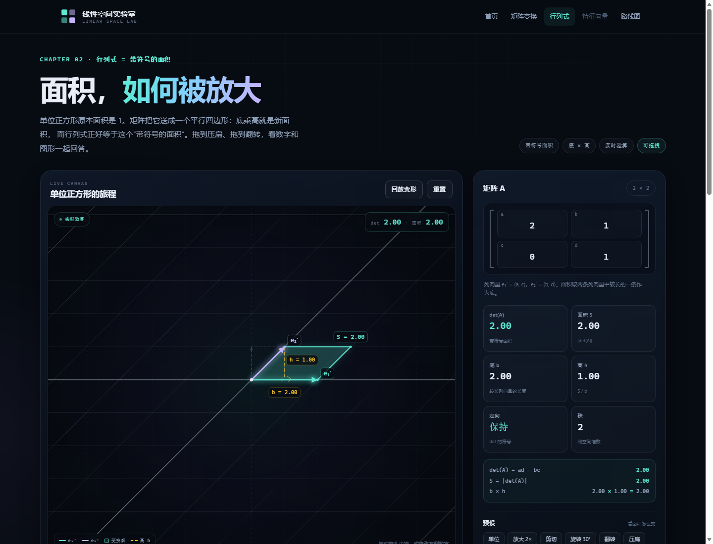

# 线性空间实验室 · Linear Space Lab

> 把矩阵，看成一次空间的呼吸。
>
> 一个纯前端、零依赖、可拖动的线性代数可视化实验室。目标不是“讲完一章”，而是让你在 10 分钟内对“矩阵到底做了什么”形成可触摸的直觉。



---

## 这是什么

屏幕上是坐标网格和两个基向量。修改 2×2 矩阵的四个数字，或者直接拖动箭头尖端，整个网格、单位方格、单位圆会连续形变；旁边实时显示行列式、面积缩放、秩、定向与特征方向。

当前是 **v0.2**：基础设施 + 矩阵变换 Demo + 行列式（面积）Demo，P1 核心直觉闭环进行中。

### 现在能玩

- **矩阵变换**：四个数字输入框实时改变矩阵，网格连续形变；拖动基向量；预设；行列式/秩/定向/特征值读数；单位方格、单位圆、特征方向图层
- **行列式 = 面积**：单位正方形被送成平行四边形，实时验证 `S = |det(A)| = 底 × 高`；拖到 `det = 0` 看面积归零；负行列式时图形翻面
- 两页都带“先猜后验”选择题与小挑战，支持桌面 / 手机 / `file://` 直接打开



### 现在还没有

- 3D、后端、账号、数据库
- 特征向量 / 方程组独立展厅
- 物理、经济、图像、硬件应用页

这些都在 [ROADMAP.md](ROADMAP.md) 里分阶段排期。

> **技术基线：** HTML5 + 原生 JavaScript + Canvas 2D。早期资料中的 React / TypeScript 方案暂缓——当前阶段优先保证“双击就能打开、零依赖、可审计”，不引入构建链。数学与绘图严格分层，未来换渲染层不影响公式。

---

## 快速开始

**方式一：直接打开（推荐）**

双击 `index.html`，或把 `index.html` 拖进浏览器。所有脚本都是普通 `<script>`，`file://` 可直接运行，不需要服务器。

**方式二：本地静态服务（可选）**

```bash
python -m http.server 8000
```

然后访问 `http://127.0.0.1:8000/`。

> 不需要 `npm install`，没有构建步骤，没有 CDN 依赖。

---

## 目录结构

```text
.
├── index.html                  首页 / 展厅总目录
├── pages/
│   ├── 01-transform.html       矩阵变换
│   ├── 02-determinant.html     行列式 = 面积
│   └── applications/           四大领域应用区（预留）
├── css/
│   ├── main.css                全站样式
│   └── canvas.css              画布页样式
├── js/
│   ├── lib/
│   │   ├── math.js             纯数学函数（无 DOM）
│   │   └── canvas-utils.js     绘图工具（无矩阵公式）
│   └── demos/
│       ├── transform.js        矩阵变换页控制器
│       └── determinant.js      行列式页控制器
├── assets/images/              静态素材
├── tests/math.test.js          数学基准测试（Node）
├── RULES.md                    项目纪律与安全红线
├── MANUAL.md                   给老板的操作手册
├── ROADMAP.md                  四阶段路线图
└── .gitignore
```

**分层原则：** `math.js` 只算，`canvas-utils.js` 只画，`demos/*.js` 只做状态与交互。数学可单独测试，绘图可复用，页面之间低耦合。

---

## 数学自测

需要 Node.js（仅开发时用，运行页面不需要）：

```bash
node tests/math.test.js
```

测试覆盖：单位矩阵、旋转 90°、缩放、剪切、奇异矩阵、逆矩阵、矩阵复合顺序、对称矩阵特征值、复特征值、投影、插值，以及随机矩阵的 `A⁻¹A ≈ I` 与 `det` 一致性。

---

## 路线图

| 阶段 | 内容 | 状态 |
|---|---|---|
| P0 | 基建 + 2D 矩阵变换 | ✅ |
| P1 | 行列式 ✅、秩/零空间、特征向量、方程组 | 🚧 |
| P2 | 物理：受力分解、刚体旋转、量子态叠加 | ⬜ |
| P3 | 经济：列昂惕夫投入产出、投资组合 | ⬜ |
| P4 | 软件：图像卷积、PCA 降维 | ⬜ |
| P5 | 硬件：音频滤波、纠错码 | ⬜ |
| P6 | 整合、无障碍、开源发布 | ⬜ |

完整验收口径见 [ROADMAP.md](ROADMAP.md)。

---

## 项目规则

开发与协作遵守 [RULES.md](RULES.md)：绿灯自动执行本地开发与提交；删除、安装依赖、推送远程等黄灯操作必须申请安全密钥；越界、破坏性命令、凭据操作是红灯，绝对禁止。

给老板的日常操作、加功能流程、Git 存档与 F12 急救，见 [MANUAL.md](MANUAL.md)。

---

## 设计原则

1. **先猜后验**：每个交互先让人预测，再让空间给出结果，不直接播放“标准答案”。
2. **数学可复算**：页面上每个数字都能由纯函数算出来；视觉上说得通但数学上不对，等于没做。
3. **显式状态**：矩阵状态只保存一份，动画只做插值；不增量累乘，保证可逆、无累积误差。
4. **低耦合**：数学、绘图、页面三层单向依赖；删掉一个展厅，其他展厅照常运行。
5. **零依赖**：不为了一个滑块引入框架；离线、可审计、能直接打开。

---

## 许可与免责声明

代码拟采用 **MIT License**；原创文字、图示与练习拟采用 **CC BY-SA 4.0**；第三方素材将逐个登记来源与许可。正式开源发布前会补齐 `LICENSE`、`LICENSES/` 与 `NOTICE`。

> 本项目为独立开源项目，与 MIT、Gilbert Strang 教授及 3Blue1Brown 均无隶属或背书关系。项目内容为原创，参考来源仅以链接与出处形式标注。

---

## 贡献

当前处于早期阶段，接口与目录仍可能调整。提交前请先读 `RULES.md` 与 `ROADMAP.md`；新增内容必须说明数学依据、验收方式与素材来源。不要提交内部资料、密钥、本机绝对路径或未授权素材。
