# Linear Algebra · 线性代数可视化实验室

一个纯前端、零依赖的线性代数可视化实验室。先选一个起点，再从平面和空间里理解矩阵。

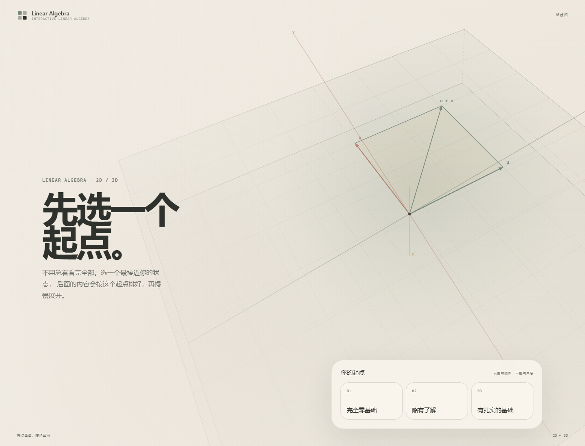

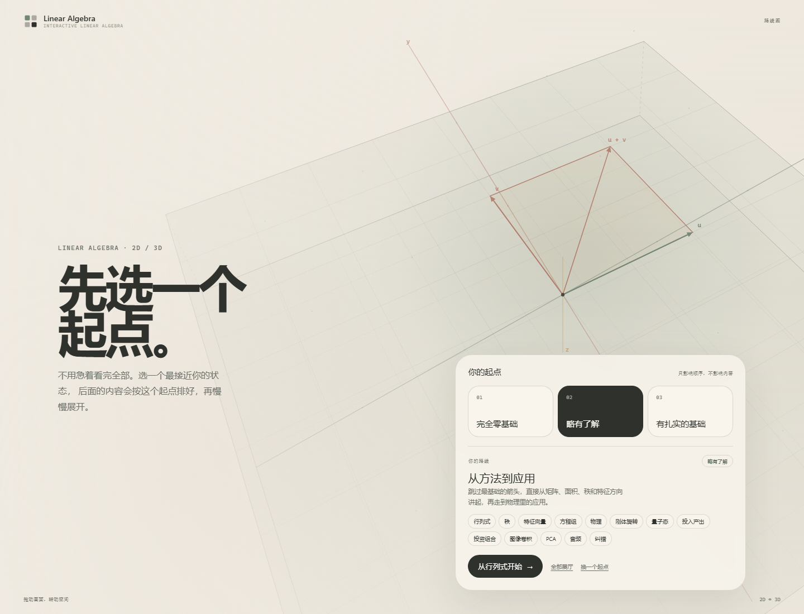

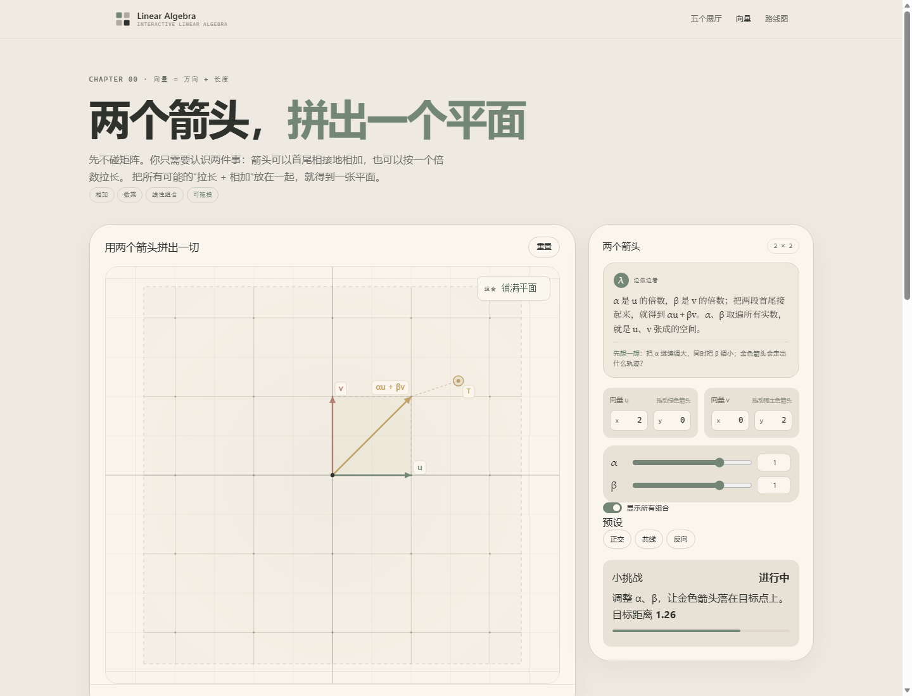


---

## 这是什么

屏幕上是坐标网格和两个基向量。修改 2×2 矩阵的四个数字，或者直接拖动箭头尖端，整个网格、单位方格、单位圆会连续形变；旁边实时显示行列式、面积缩放、秩、定向与特征方向。

当前是 **v2.8**：带水平选择的 3D 入口 + 零基础向量课 + 五个基础展厅 + 十三个跨域应用 + 全屏无限空间 + 本地账号与数据面板 + 应用地图 + 发布检查 + 开源发布清单。P1–P8 代码侧完成。

### 现在能玩

- **向量与组合（零基础）**：拖动两个箭头，调 α、β，看 αu + βv 怎样铺满或退化成一个方向
- **矩阵变换**：四个数字输入框实时改变矩阵，网格连续形变；拖动基向量；预设；行列式/秩/定向/特征值读数；单位方格、单位圆、特征方向图层
- **行列式 = 面积**：单位正方形被送成平行四边形，实时验证 `S = |det(A)| = 底 × 高`；拖到 `det = 0` 看面积归零；负行列式时图形翻面
- **秩与零空间**：看平面被压成线或点；拖动橙色探测向量 x，观察 Ax 如何变短；当 Ax = 0 时找到零空间；实时验证 `rank + nullity = 2`
- **特征向量**：拖动橙色探测向量 v，寻找与 Av 共线的“不转向方向”；实特征值、复特征值、重根与全部方向都有各自的显示
- **线性方程组**：行视角看两条约束线的交点，列视角看两列如何组合出 b；唯一解、无解、无穷多解用同一个状态机解释
- **入口**：先选「完全零基础 / 略有了解 / 有扎实的基础」，入口的 3D 平面会跟着指针与选择变化，再显示对应路线
- **物理 · 受力分解**：两根绳子悬挂重物，把力分解成 `T₁u + T₂v = −W`；拖动锚点或重物，观察张力、负张力和松弛
- **物理 · 刚体旋转**：用 `R(θ)` 转动圆和刚体，验证 `RᵀR = I`、长度 / 夹角 / det 不变；切到普通矩阵看圆变椭圆
- **物理 · 量子态**：用 `α|0⟩ + β|1⟩` 看两个复振幅、归一化和 Born 规则；θ 调概率，φ 调相位
- **经济 · 投入产出**：两个行业互相供货；左右拖动需求框里的金点调 d，解 `(I − A)x = d`，看总产出和逆矩阵
- **经济 · 投资组合**：拖金点调权重，左右拖协方差椭圆调 ρ；看有效前沿和协方差矩阵的特征向量
- **软件 · 图像卷积**：拖动 3×3 窗口，看卷积核把局部像素按权重压成一个输出；可换恒等 / 模糊 / 边缘 / 锐化 / 浮雕核
- **软件 · PCA 降维**：拖动主轴 / 调拉伸；看点云主方向、一维投影和协方差矩阵特征向量
- **硬件 · 音频 FIR**：拖动播放头和 5 个 tap，看时间轴上的加权和怎样改变波形
- **硬件 · 纠错码**：点码字位注入错误，用 Hamming(7,4) 的 syndrome 定位并纠正
- **计算机 · 三维投影**：拖动立方体，先乘 3×3 旋转矩阵、再除以深度，落到二维屏幕
- **美术 · 一点透视**：地砖越远越窄，拖消失点，看平行线怎样在远处相遇
- **音乐 · 和弦与频谱**：三个频率按振幅叠加成波形；直接在频谱框里拖柱子改振幅，频谱柱就是这组系数
- **社会科学 · 意见演化**：把互相影响写成矩阵反复相乘；在柱状图框里拖柱子改初始分布，分布收敛到特征向量
- **练习与测试**：每章三档练习（各 17 题、百分制）+ 章节大测（23 题、200 分）；选择、填空、大题三种题型，大题可直接写推导（公式工具栏 + `\alpha` 自动补全）；5 种测试模式、倒计时、25 分钟提醒、逐题解析与出处、原题下载
- **应用地图**：按物理 / 经济 / 软件 / 硬件 / 美术 / 音乐 / 社会科学筛选十三个入口，一页看完跨域索引
- **账号与数据面板**：本地后端记录正确率、测试分数、学习进度，柱状图 / 饼状图 / 折线图查看；不登录完全不影响使用
- **全屏无限空间**：六个基础展厅点右上角「全屏」，方格纸铺满窗口、可以平移缩放；右上角全局地图、正下方讲解条，`Esc` 退出。十三个应用页也有「全屏」：空间类页面带小地图与滚轮缩放，图表类页面是纯观看模式，拖动手柄照常
- **入口直达**：入口的路线标签（物理、三维投影、和弦与频谱……）都是可点的入口，不再有灰色占位
- **发布检查**：数学测试、交互、键盘可访问性与已知限制，集中在一页核对
- 零基础向量课和五个展厅都带“先猜后验”选择题与小挑战；右侧“边做边看”会跟着你的每一次拖动即时解释，不用往下翻
- 选了哪条路线，页面顶部就会出现对应的“第 N 站”提示、下一站链接和“这一站怎么学”的提示
- “有扎实的基础”路线会隐藏基础 quiz、提高挑战精度；零基础路线会多给一条读图提示，挑战容差也更宽松
- 略有了解 / 有扎实的基础会在路线卡里直接看到本页公式；零基础先看文字和画面
- 全部展厅收在 `pages/library.html`：可拖动的地球仪，指针停下的图标会放大
- 支持桌面 / 手机 / `file://` 直接打开


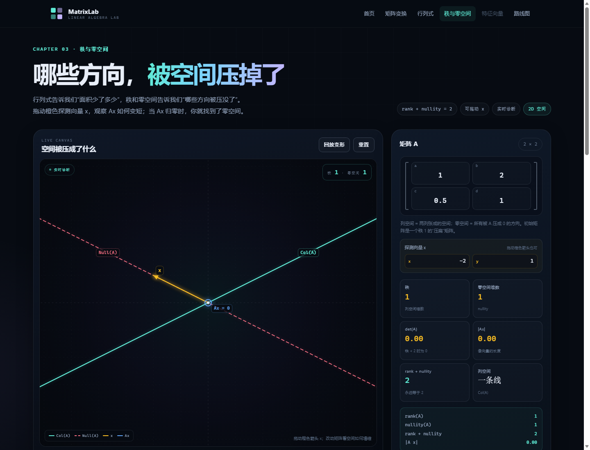

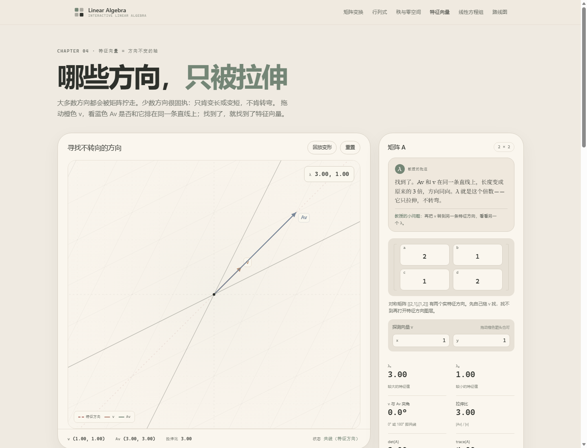

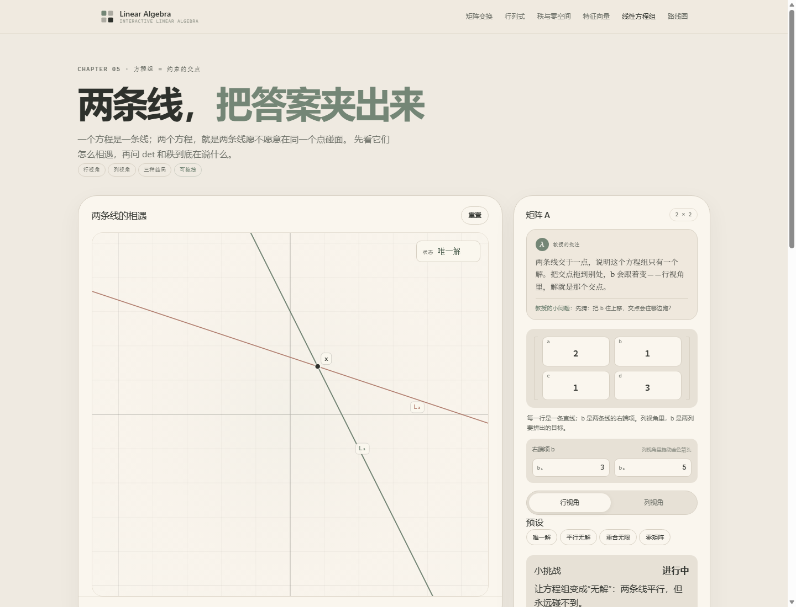

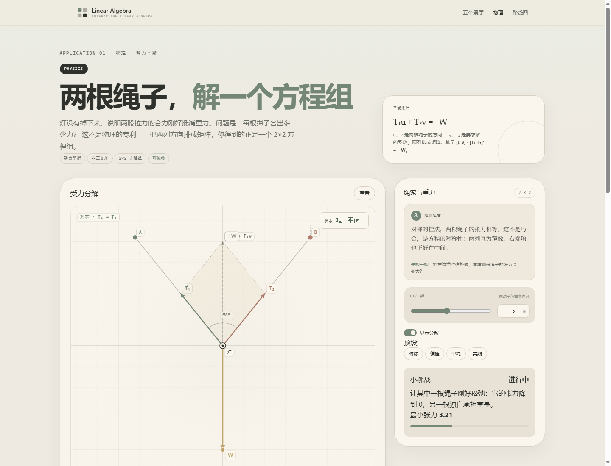

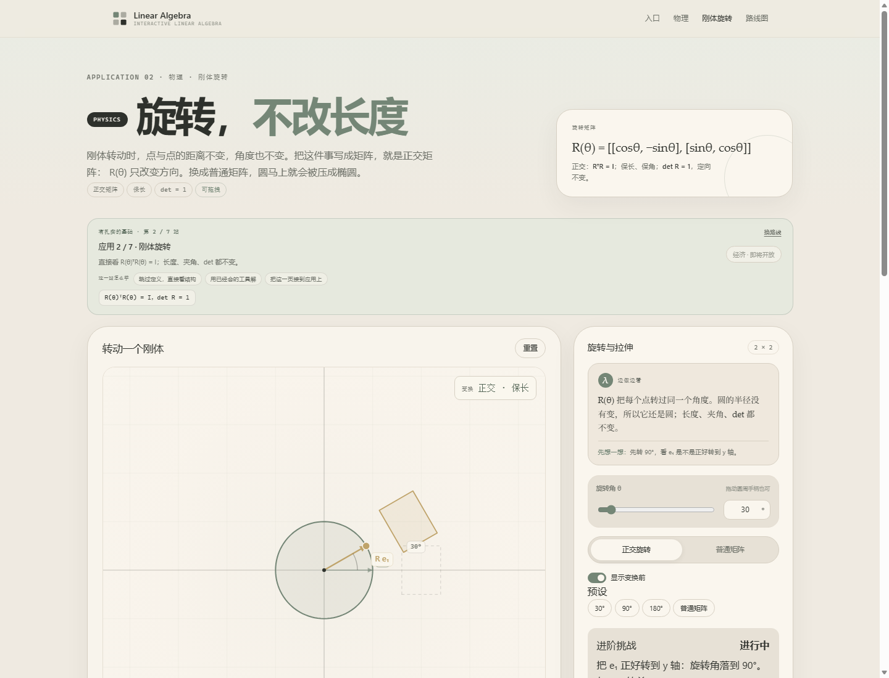

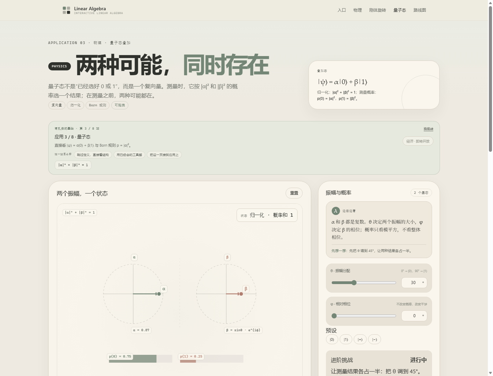

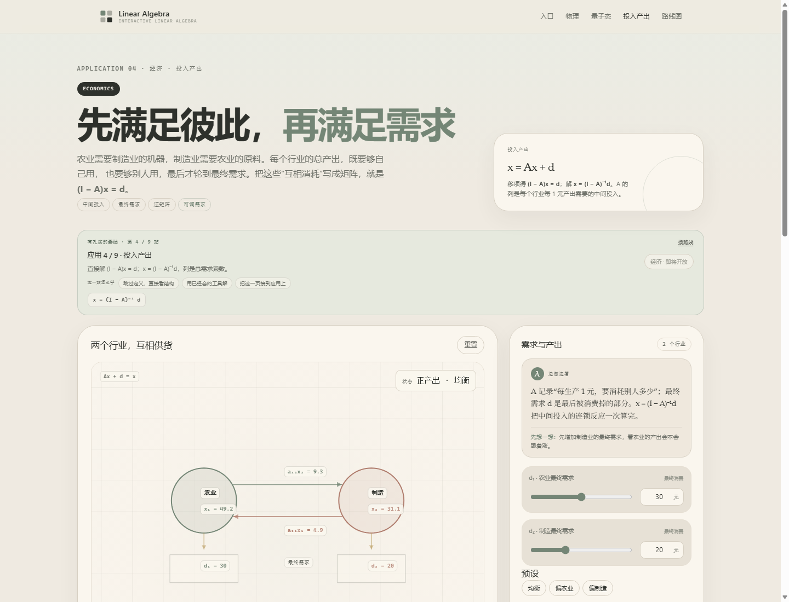

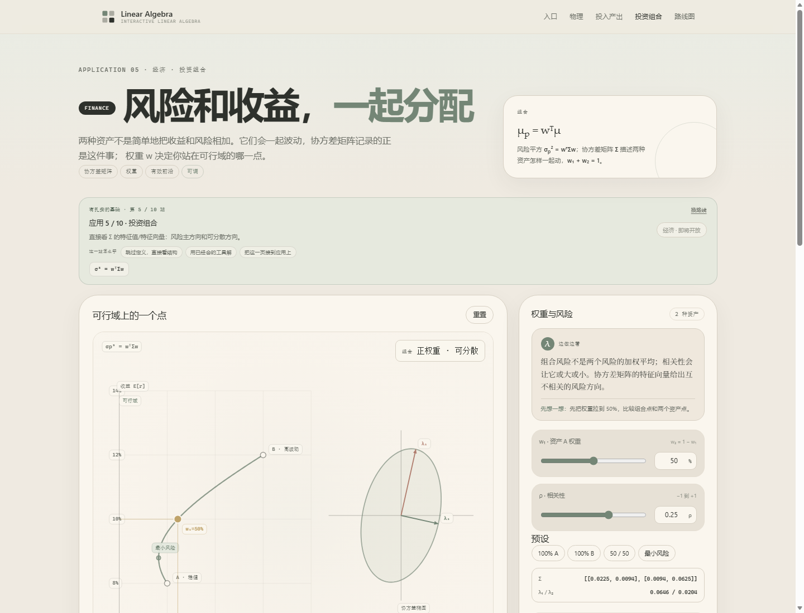


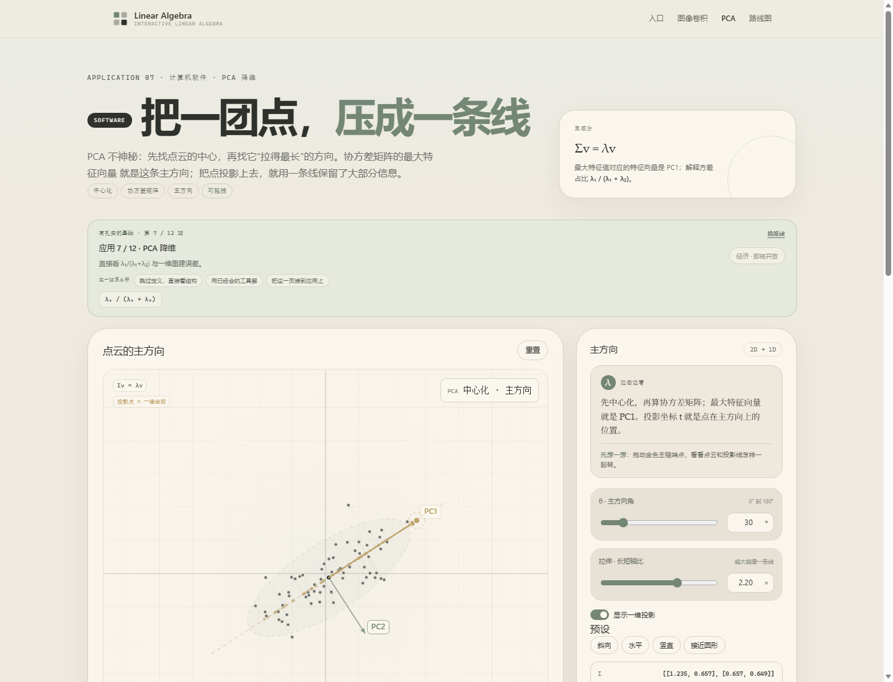

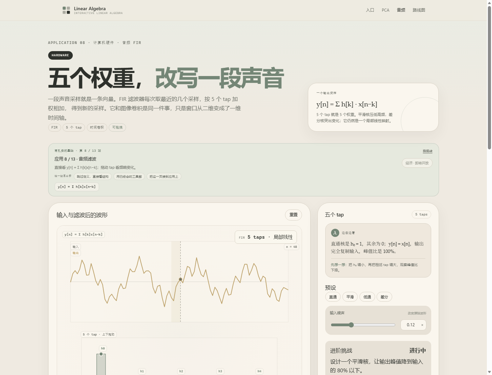

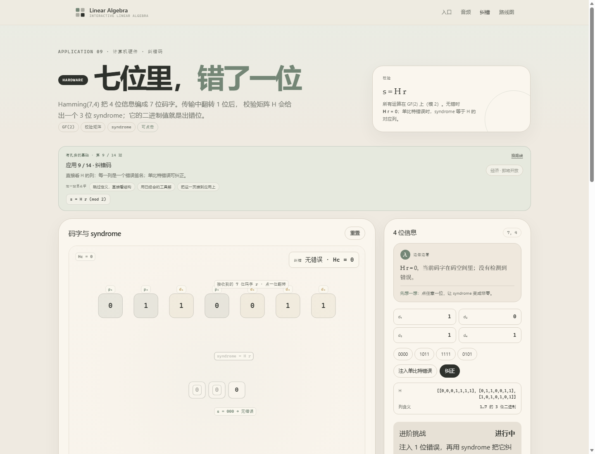


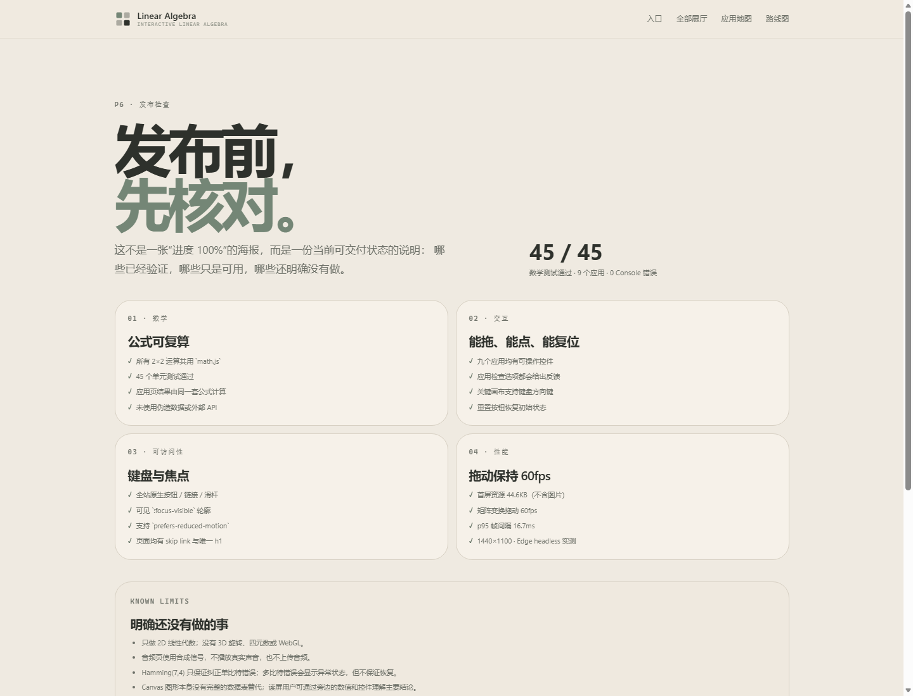

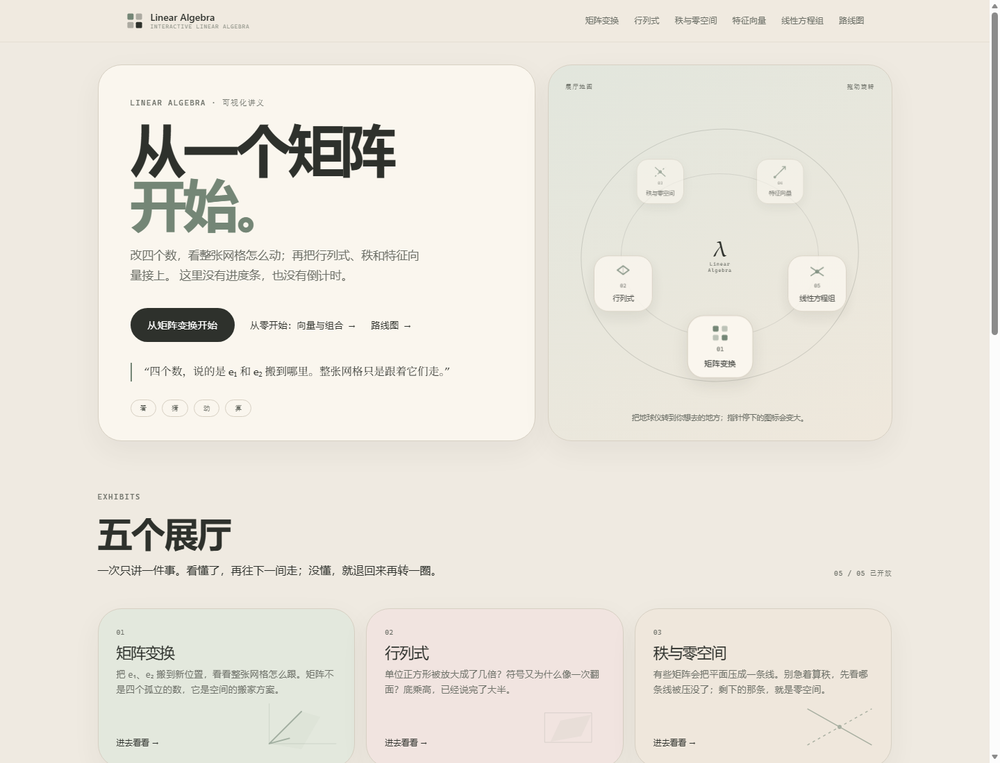

### 现在还没有

- 练习题题库与章节测试（路线图第 4 项）
- 学习路线图 / 地图海报（路线图第 5 项）
- 真实 WebGL / 3D 渲染；入口与投影页的空间感来自 Canvas 2D 投影

这些都在 [ROADMAP.md](ROADMAP.md) 里分阶段排期。参考来源与使用边界见 [REFERENCES.md](REFERENCES.md)；想改某一块，先看 [ARCHITECTURE.md](ARCHITECTURE.md) 的分区表。

> **技术基线：** HTML5 + 原生 JavaScript + Canvas 2D。早期资料中的 React / TypeScript 方案暂缓——当前阶段优先保证“双击就能打开、零依赖、可审计”，不引入构建链。数学与绘图严格分层，未来换渲染层不影响公式。

---

## 快速开始

**方式一：直接打开（推荐）**

双击 `index.html`，或把 `index.html` 拖进浏览器。所有脚本都是普通 `<script>`，`file://` 可直接运行，不需要服务器。
不启动服务时，登录会自动降级为「离线」提示，**全部内容与练习照常使用**。

**方式二：本地服务（要账号 / 数据面板时用）**

双击 `start-server.bat`，或在项目根目录运行：

```bash
node server/app.js
```

然后访问 `http://127.0.0.1:4173/`。服务只监听 `127.0.0.1`，账号与数据都存在本机
`data/linear-algebra.db`。

> 不需要 `npm install`，没有构建步骤，没有 CDN 依赖；后端只用 Node 自带的 `http` 与 `node:sqlite`。

### 账号与数据

- 不登录：所有展厅、应用、练习、全屏空间都能用；
- 登录：多一份「用户使用数据库」，记录练习正确率、测试分数、学习进度；
- 数据面板：`pages/dashboard.html`，用柱状图 / 饼状图 / 折线图看这些数字；
- 隐私：密码只存加盐哈希，数据只在本机，可随时在数据面板里删除账号与全部记录。

### 练习与测试

每个章节页末尾都有「简单 / 进阶 / 挑战」三档练习（各 17 题，百分制）和章节大测（23 题，200 分），每份都含选择、填空与需要写推导的大题。
开始前可选 5 种方式：限时打分、限时只对答案、不限时打分、不限时不打分、跳过；
限时模式有倒计时，每 25 分钟提醒一次。大题作答有数学符号工具栏，输入 `\alpha`、`\sqrt` 会补全成 α、√。交卷后选择题与填空题自动判分，大题按参考答案自评；逐题给解析与出处，并能一键下载「原题 + 答案解析」。
登录后成绩与正确率会进数据面板。

---

## 目录结构

```text
.
├── index.html                  3D 入口 / 水平选择
├── start-server.bat            启动本地服务（账号与数据面板用）
├── server/
│   ├── app.js                  HTTP 服务 + /api 路由 + 静态托管
│   ├── db.js                   SQLite 表结构与查询
│   └── auth.js                 scrypt 密码哈希、会话 cookie
├── pages/
│   ├── library.html            全部展厅 / 章节地球仪
│   ├── dashboard.html          用户数据面板（柱状图 / 饼状图 / 折线图）
│   ├── practice.html           练习与章节大测
│   ├── 00-vectors.html         向量与线性组合（零基础）
│   ├── 01-transform.html       矩阵变换
│   ├── 02-determinant.html     行列式 = 面积
│   ├── 03-rank.html            秩与零空间
│   ├── 04-eigenvector.html      特征向量
│   ├── 05-solve.html           线性方程组
│   └── applications/
│       ├── physics.html       物理 · 受力分解
│       ├── physics-rotation.html 物理 · 刚体旋转
│       ├── physics-quantum.html 物理 · 量子态
│       ├── economics-leontief.html 经济 · 投入产出
│       ├── economics-portfolio.html 经济 · 投资组合
│       ├── software-convolution.html 软件 · 图像卷积
│       ├── software-pca.html 软件 · PCA 降维
│       ├── hardware-audio.html 硬件 · 音频 FIR
│       ├── hardware-ecc.html 硬件 · 纠错码
│       ├── computer-projection.html 计算机 · 三维投影
│       ├── art-perspective.html 美术 · 一点透视
│       ├── music-harmony.html 音乐 · 和弦与频谱
│       ├── social-opinion.html 社会科学 · 意见演化
│       ├── atlas.html          应用地图 / 跨域索引
│       └── release.html        发布检查 / 已知限制
├── css/
│   ├── main.css                全站样式与莫兰迪色板
│   ├── entry.css               3D 入口、水平选择
│   ├── bento.css               全部展厅便当盒、章节地球仪
│   ├── canvas.css              画布页、即时旁白
│   ├── space.css               全屏无限空间、全局地图、底部讲解条
│   ├── account.css             入口账号卡、登录弹窗
│   ├── dashboard.css           数据面板与图表
│   ├── practice.css            练习与测试
│   ├── applications.css        应用篇布局、物理控制
│   └── atlas.css               应用地图与跨域索引
├── js/
│   ├── lib/
│   │   ├── math.js             纯数学函数（无 DOM）
│   │   ├── canvas-utils.js     绘图工具（无矩阵公式）
│   │   ├── narration.js        即时旁白文案生成器
│   │   ├── chapter-globe.js    可拖动章节地球仪
│   │   ├── entry-scene.js      入口 3D 透视图
│   │   ├── entry-flow.js       水平选择与路线
│   │   ├── paths.js            三条路线的唯一配置
│   │   ├── level-ui.js         页面顶部的路线提示
│   │   ├── space-mode.js       全屏无限空间、全局地图、讲解条
│   │   ├── account.js          本地账号：登录、注册、记录、统计
│   │   ├── record.js           章节访问与答题记录
│   │   ├── practice.js         练习 / 测试引擎（模式、计时、判分、下载）
│   │   ├── questions/          六章题库（每章 18 道练习 + 8 道大测）
│   │   └── atlas.js            应用地图筛选
│   └── demos/
│       ├── vectors.js          向量与组合页控制器
│       ├── transform.js        矩阵变换页控制器
│       ├── determinant.js      行列式页控制器
│       ├── rank.js             秩与零空间页控制器
│       ├── eigenvector.js      特征向量页控制器
│       ├── solve.js            线性方程组页控制器
│       ├── physics-force.js    物理受力分解控制器
│       ├── physics-rotation.js 物理刚体旋转控制器
│       ├── physics-quantum.js 物理量子态控制器
│       ├── economics-leontief.js 经济投入产出控制器
│       ├── economics-portfolio.js 经济投资组合控制器
│       ├── software-convolution.js 图像卷积控制器
│       ├── software-pca.js PCA 降维控制器
│       ├── hardware-audio.js 音频 FIR 控制器
│       ├── hardware-ecc.js Hamming 纠错控制器
│       ├── computer-projection.js 三维投影控制器
│       ├── art-perspective.js 一点透视控制器
│       ├── music-harmony.js 和弦与频谱控制器
│       ├── social-opinion.js 意见演化控制器
│       ├── dashboard.js        数据面板与图表
│       ├── atlas.js            应用地图筛选
│       └── release.html        发布检查页
├── assets/images/              静态素材
├── tests/math.test.js          数学基准测试（Node）
├── tests/perf-check.js         可选性能测量（需要 Edge / CDP）
├── PERFORMANCE.md              性能门线与测试条件
├── RULES.md                    项目纪律与安全红线
├── MANUAL.md                   给开发者的操作手册
├── ROADMAP.md                  四阶段路线图
├── REFERENCES.md               参考来源与使用边界
├── ARCHITECTURE.md             分区、分层与迭代指南
└── .gitignore
```

**分层原则：** `math.js` 只算，`canvas-utils.js` 只画，`demos/*.js` 只做状态与交互。数学可单独测试，绘图可复用，页面之间低耦合。

---

## 自测

需要 Node.js（仅开发时用，运行页面不需要）：

```bash
node tests/math.test.js
node tests/api.test.js
```

`math.test.js` 覆盖：单位矩阵、旋转 90°、缩放、剪切、奇异矩阵、逆矩阵、矩阵复合顺序、对称矩阵特征值、复特征值、投影、插值，随机矩阵的 `A⁻¹A ≈ I` 与 `det` 一致性，列空间 / 零空间与 `rank + nullity = 2`，以及 3D 的 `mat3` 乘法、旋转保长度与透视投影。

`api.test.js` 会启动一个临时数据目录的服务实例，跑完整流程：注册、重复用户名、弱密码、登录、记录、统计、退出、删除账号，以及静态文件与越界路径。

---

## 路线图

| 阶段 | 内容 | 状态 |
|---|---|---|
| P0 | 基建 + 2D 矩阵变换 | ✅ |
| P1 | 行列式 ✅、秩/零空间 ✅、特征向量 ✅、方程组 ✅ | ✅ |
| P2 | 物理：受力分解 ✅、刚体旋转 ✅、量子态叠加 ✅ | ✅ |
| P3 | 经济：列昂惕夫投入产出 ✅、投资组合 ✅ | ✅ |
| P4 | 软件：图像卷积 ✅、PCA 降维 ✅ | ✅ |
| P5 | 硬件：音频滤波 ✅、纠错码 ✅ | ✅ |
| P6 | 跨域索引 ✅、键盘/焦点 ✅、开源清单 ✅、性能 60fps / 44.6KB ✅ | ✅ |
| P7 | 全屏无限空间 ✅、计算机 / 美术 / 音乐 / 社会科学应用页 ✅（十三个入口） | ✅ |
| P8 | 本地账号 ✅、SQLite 记录 ✅、数据面板 ✅（柱状图 / 饼状图 / 折线图） | ✅ |
| P9 | 三档练习 ✅、200 分章节大测 ✅、5 种测试模式 ✅、计时与提醒 ✅、题库自检 ✅ | ✅ |

完整验收口径见 [ROADMAP.md](ROADMAP.md)。

---

## 项目规则

开发与协作遵守 [RULES.md](RULES.md)：绿灯自动执行本地开发与提交；删除、安装依赖、推送远程等黄灯操作必须申请安全密钥；越界、破坏性命令、凭据操作是红灯，绝对禁止。

给开发者的日常操作、加功能流程、Git 存档与 F12 急救，见 [MANUAL.md](MANUAL.md)。

---

## 设计原则

1. **先猜后验**：每个交互先让人预测，再让空间给出结果，不直接播放“标准答案”。
2. **数学可复算**：页面上每个数字都能由纯函数算出来；视觉上说得通但数学上不对，等于没做。
3. **显式状态**：矩阵状态只保存一份，动画只做插值；不增量累乘，保证可逆、无累积误差。
4. **低耦合**：数学、绘图、页面三层单向依赖；删掉一个展厅，其他展厅照常运行。
5. **零依赖**：不为了一个滑块引入框架；离线、可审计、能直接打开。

---

## 许可与免责声明

- 代码（HTML / CSS / JavaScript / 测试）：**MIT License**，见 [`LICENSE`](LICENSE)。
- 原创文字、图示、练习与项目截图：**CC BY-SA 4.0**，见 [`LICENSES/CC-BY-SA-4.0.txt`](LICENSES/CC-BY-SA-4.0.txt)。
- 第三方引用与商标归属：见 [`NOTICE`](NOTICE)。
- 贡献方式：见 [`CONTRIBUTING.md`](CONTRIBUTING.md)；安全问题：见 [`SECURITY.md`](SECURITY.md)。

> 本项目为独立开源项目，与 MIT、Gilbert Strang 教授及 3Blue1Brown 均无隶属或背书关系。项目内容为原创，参考来源仅以链接与出处形式标注。

---

## 贡献

当前处于早期阶段，接口与目录仍可能调整。提交前请先读 `CONTRIBUTING.md`、`RULES.md` 与 `ROADMAP.md`；新增内容必须说明数学依据、验收方式与素材来源。不要提交内部资料、密钥、本机绝对路径或未授权素材。
